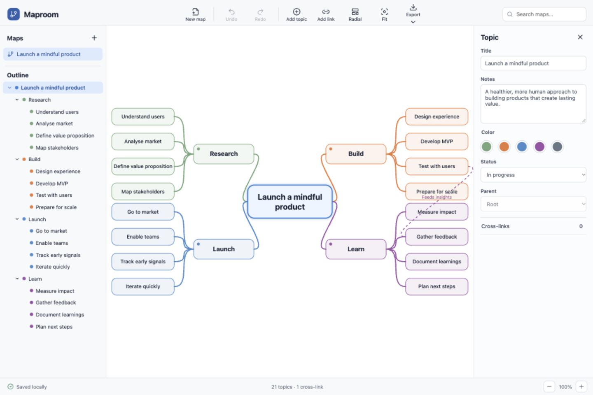

# Maproom

**Mind maps for AI-assisted software development.** Maproom gives AI agents a structured canvas for exploring a codebase, planning features, mapping architecture, and communicating technical decisions. People can inspect and edit the same maps in a browser while agents work through the Model Context Protocol (MCP).



Maproom is a local-first project: the browser editor and MCP server share a JSON map store on your machine. The editor runs on macOS, Linux, or Windows with a supported Node.js release. This first release is a useful MVP for planning and development diagrams; it does not inspect source repositories or automatically generate maps from code.

## What you can map

- Software architecture: services, components, data stores, APIs, and their relationships
- Feature design: user goals, flows, constraints, implementation branches, and acceptance criteria
- Domain models: entities, concepts, ownership, and dependencies
- Engineering plans: milestones, tasks, risks, decisions, and release readiness
- Operational thinking: incident causes, mitigations, recovery paths, and runbooks

The map structure supports nested topics, notes, progress status, branch colours, and labelled cross-links. Layouts include radial, left-to-right, right-to-left, and organisation chart.

## Quick start

Requirements: Node.js 22.19+, 24.11+, or 26+, and npm. From a terminal:

```bash
git clone https://github.com/Raggertooth/maproom.git
cd maproom
npm ci
npm run build
npm start
```

Then open [http://127.0.0.1:4318](http://127.0.0.1:4318). Maproom creates a starter map the first time it runs. The server binds to the local computer only.

To work on the source with live reload, use `npm run dev`; the Vite UI runs at `http://127.0.0.1:5173` and sends API requests to the local server at port 4318.

## Connect an AI agent

Maproom exposes an MCP server over stdio. Build once with `npm run build`, then register the absolute path to `dist/server/mcp.js` in your MCP host. For example, a Codex configuration can look like:

```toml
[mcp_servers.maproom]
command = "node"
args = ["/absolute/path/to/maproom/dist/server/mcp.js"]
env = { MAPROOM_DATA_PATH = "/absolute/path/to/maproom/data/maps.json" }
```

Set `MAPROOM_DATA_PATH` to the same file for the browser server and MCP process so they share maps. Restart the MCP host after saving its configuration. See [Agent setup](docs/agent-setup.md) for more detail and example prompts.

### Available tools

| Tool | Purpose |
| --- | --- |
| `list_maps` | List saved maps and their basic metadata |
| `get_map` | Read a map as structured JSON |
| `create_map` | Create a map with a root topic |
| `add_topics` | Add one or more nested topics |
| `update_topic` | Change a topic’s text, notes, status, colour, or parent |
| `remove_topic` | Remove a topic and its descendants |
| `connect_topics` | Add or update a labelled cross-link |
| `set_layout` | Select a visual layout |
| `export_map` | Return a map as OPML or SVG |

## Exports and data

The editor can export OPML and SVG, create PNG images, and print to PDF. Map data is stored locally in `data/maps.json`; set `MAPROOM_DATA_PATH` to choose another location. OPML is a portable outline format and does not include every visual property of a Maproom map. See [Data format and exports](docs/data-format-and-exports.md).

## Documentation

- [Agent setup](docs/agent-setup.md) — MCP configuration and prompt patterns
- [Development diagram patterns](docs/development-diagrams.md) — practical examples for software design work
- [Architecture](docs/architecture.md) — components, data flow, and design decisions
- [Data format and exports](docs/data-format-and-exports.md) — map model, storage, and export boundaries
- [Development guide](docs/development.md) — local setup and project structure
- [Contributing](CONTRIBUTING.md) — how to propose changes
- [Security](SECURITY.md) — local network boundary and vulnerability reporting
- [MIT License](LICENSE) — reuse and distribution terms

## Current limitations

- The MCP interface is local stdio; it is not a hosted or remote MCP service.
- Maps are stored in one local JSON file; there is no cloud sync, multi-user editing, or authentication.
- Agents do not automatically read source repositories. Give an agent the relevant code or repository tools, then ask it to represent its findings in Maproom.
- Layout is generated automatically. Users can edit the map structure and content, but there is no freeform drag-and-drop canvas yet.
- Interchange formats preserve outline content, while some Maproom-specific visual details may not transfer.

## Project status

Maproom is an early, working project. The editor and MCP tools are implemented; the data model and export formats may evolve. Maproom is distributed under the MIT License. See [LICENSE](LICENSE) for the terms.

