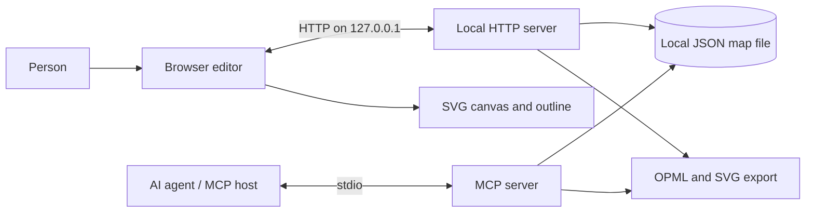

# Architecture

Maproom is a local application with two entry points over one data model: a browser-based editor for people and an MCP stdio server for AI agents.

## Components

- `src/shared/types.ts` defines the map, topic, link, status, and layout types.
- `src/shared/map-ops.ts` performs validated changes to map structures.
- `src/shared/layout.ts` positions topics for the editor and SVG output.
- `src/shared/exporters.ts` creates OPML outlines and standalone SVG.
- `src/server/store.ts` reads and atomically writes the local JSON store.
- `src/server/http.ts` serves the static editor and its local JSON API.
- `src/server/mcp.ts` registers the agent-facing MCP tools.
- `src/client/` contains the React editor, outline, canvas, and topic inspector.

The browser does not connect directly to the MCP process. Both processes use the same store file, selected with `MAPROOM_DATA_PATH` or resolved as `data/maps.json` from each process's current working directory.

## Data flow

1. A person edits a map in the browser; the client sends the updated structured map to the HTTP server.
2. The HTTP server validates and saves the map to JSON.
3. An MCP host starts the MCP server as a local subprocess; tool calls read and update that same JSON store.
4. The browser sees agent edits after it refreshes or reloads its map data.
5. The editor or MCP `export_map` tool renders OPML or SVG from the structured map.

## Design decisions

- **Local-first:** maps stay in a file on the machine; there is no hosted storage service.
- **MCP over stdio:** the MCP host owns the subprocess lifecycle and no network listener is needed for agent access.
- **HTTP bound to loopback:** the editor API listens on `127.0.0.1` and has no authentication layer; it is intended for local use.
- **Portable structure:** the map is stored as JSON, with OPML for outline exchange and SVG for a static visual.
- **Generated layout:** radial and directional layouts make maps readable without requiring freeform positioning.

## Current boundaries

The application has no user accounts, multi-user synchronization, hosted service, typed diagram connectors, or source-code indexing. Concurrent edits from separate processes are not coordinated; avoid simultaneously editing the same map from multiple clients. The HTTP API is not designed for exposure to a LAN or the public internet.
